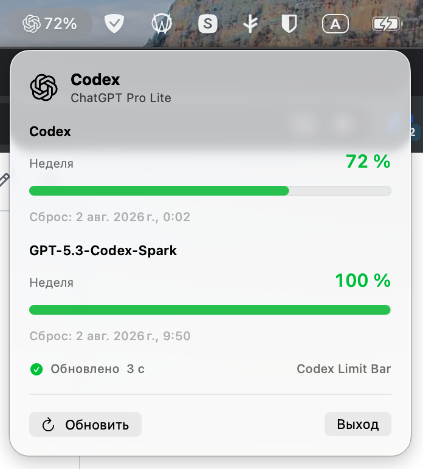

<p align="center">
  <a href="README.md">Русский</a> · <b>English</b>
</p>

<p align="center">
  
</p>

<h1 align="center">Codex Limit Bar</h1>

<p align="center">
  A native OpenAI Codex usage-limit indicator for the macOS menu bar.
</p>

<p align="center">
  <a href="https://github.com/svllvsxprod/codex_limitbar/releases/latest">Download the latest release</a>
</p>

<table align="center">
  <tr>
    <td align="center" width="760">
      <h3>Support development</h3>
      <p>Your support helps improve the app, validate new Codex releases, and prepare signed builds.</p>
      <table align="center">
        <tr>
          <td align="center" width="350"><a href="https://t.me/tribute/app?startapp=dK9j"></a></td>
          <td align="center" width="350"><a href="https://nowpayments.io/donation/svllvsx"></a></td>
        </tr>
        <tr>
          <td align="center" colspan="2"><a href="https://t.me/svllvsxprod"></a></td>
        </tr>
      </table>
    </td>
  </tr>
</table>

<p align="center">
  
  
  
  
</p>

<p align="center">
  <a href="#features">Features</a> ·
  <a href="#installation">Installation</a> ·
  <a href="#security">Security</a> ·
  <a href="#development">Development</a> ·
  <a href="#limitations">Limitations</a>
</p>

## About

Codex Limit Bar lives exclusively in the menu bar and shows the actual remaining Codex percentage, usage-window duration, and next reset time. It does not create a regular window or occupy space in the Dock.

Usage data is refreshed immediately after launch and then every three minutes in the background. The last successful result remains available as a stale snapshot when a temporary error occurs.

This project is an independent utility and is not affiliated with OpenAI.

## Interface

<p align="center">
  
</p>

## Features

- Actual remaining usage for the primary weekly or short Codex window.
- Additional model limits when they are present in the account response.
- Exact local time of the next reset.
- Explicit loading, stale-data, expired-authentication, rate-limit, network, VPN-gate, and unknown-format states.
- Manual refresh with coalescing to prevent duplicate concurrent requests.
- Background usage refresh every three minutes, including while the panel is closed.
- Optional launch at login through the system `SMAppService` API: gear button → “Launch at login”.
- Independent ChatGPT device login with an app-owned session stored in macOS Keychain.
- Dynamic remaining percentage beneath the OpenAI blossom in the menu bar.
- Accumulated primary Codex-window usage spent during the current day.
- Automatic English or Russian UI localization based on the macOS language.
- Native SwiftUI and AppKit interface, with GitHub updates powered by Sparkle 2.

## Installation

1. Download `Codex-Limit-Bar-0.4.0.dmg` from [GitHub Releases](https://github.com/svllvsxprod/codex_limitbar/releases/latest).
2. Open the DMG and drag `Codex Limit Bar.app` into `Applications`.
3. Launch the app. Because the current build is ad-hoc signed, macOS may require the first launch through the **Open** context-menu command.
4. Select **Independent sign-in** in the app panel, paste the copied code into the ChatGPT page that opens, and complete authorization.
5. To enable launch at login, click the gear in the top-right corner of the panel and turn on **Launch at login**. If macOS needs approval, click **Open Login Items…** and allow the app in System Settings. Launch the app from `Applications` first.

On the first launch from `Applications`, the app offers to enable launch at login. Choose “Not now” to leave it off; the prompt is shown only once.

Launch at login is enabled only by user choice. Existing registration is preserved when updating, and changes made in macOS System Settings are respected.

Before independent sign-in, the app may temporarily use local Codex CLI or OpenCode authentication as a read-only fallback. After sign-in, Codex Limit Bar stores and refreshes its own session independently of a running OpenCode process.

## GitHub Updates

Starting with 0.4.0, the app checks for updates every six hours. New versions are offered in the menu; settings include an automatic-check switch and **Check for Updates…**. After confirmation, Sparkle downloads the update, verifies its signature, replaces the app, and relaunches it.

The feed and update archives are signed with Ed25519. GitHub checks do not send ChatGPT tokens, and Sparkle system profiling is disabled. Users upgrading from 0.3.0 or earlier need to install the DMG manually once.

## VPN Check

Before each OpenAI request, the app concurrently sends credential-free `HEAD` requests to YouTube, Speedtest, and WhatsApp.

- If at least one service responds, the OpenAI request is allowed.
- If all three services are unavailable, the app does not read the local token or contact OpenAI.
- Each probe has a five-second timeout.

This is a product-level connectivity heuristic, not a check for a specific VPN interface or route.

## Architecture

```text
NSStatusItem + NSPopover
  -> UsageStore
  -> PublicServiceConnectivityGate
  -> ChatGPTAuthManager / Keychain
  -> LocalChatGPTAuthLoader fallback
  -> LiveCodexUsageProvider
  -> chatgpt.com/backend-api/wham/usage
```

- The UI depends on `CodexUsageProviding`, not on the transport response.
- Parsing, OAuth retry, local authentication, wake refresh, VPN gate, and refresh state are tested independently.
- Refresh requests are coalesced and cannot create overlapping polling loops.
- The release pipeline builds the `.app`, `.icns`, DMG, SHA-256 checksum, and signed `appcast.xml`.

## Security

- Tokens are never written to source code, fixtures, logs, or release artifacts.
- Authentication files are accepted only when their POSIX permissions deny group and other access.
- The app-owned Codex Limit Bar OAuth session is stored as a generic password in macOS Keychain.
- The token is kept only in memory and sent exclusively to the exact `chatgpt.com` HTTPS origin.
- VPN probes never receive the token, account ID, or other OpenAI credentials.
- The app uses ephemeral `URLSession` instances, disabled URL caching, and bounded timeouts.
- Codex and OpenCode authentication files are read-only; only the app-owned Keychain session can be updated.

Data-source details: [`docs/usage-source.md`](docs/usage-source.md).

## Development

Requirements:

- macOS 14 or newer.
- Xcode 26 / Swift 6.2 or newer.
- Apple Silicon for the current prebuilt DMG.

```bash
swift test
swift run CodexLimitBar
```

Build the app bundle:

```bash
./scripts/build-app.sh
open dist/CodexLimitBar.app
```

Build the DMG:

```bash
./scripts/build-dmg.sh
```

The DMG, SHA-256 checksum, and signed `appcast.xml` are written to `release/`. Signing requires the existing Sparkle key in Keychain; see [`release/README.md`](release/README.md).

## Limitations

- `wham/usage` is used by the official open-source Codex client but is not documented as a stable public API.
- The local OpenCode OAuth fallback is unsupported and may change with the OpenCode authentication format.
- The app does not update or take ownership of another client's OAuth credentials; independent device login creates a separate app-owned session.
- The current public DMG is built for Apple Silicon.
- The build is ad-hoc signed and not notarized by Apple; public production distribution requires Developer ID signing and notarization.
- macOS may require manual approval of the login item.
- Daily usage is derived from observed `used_percent` changes; the API cannot reconstruct usage while the app was not running.
