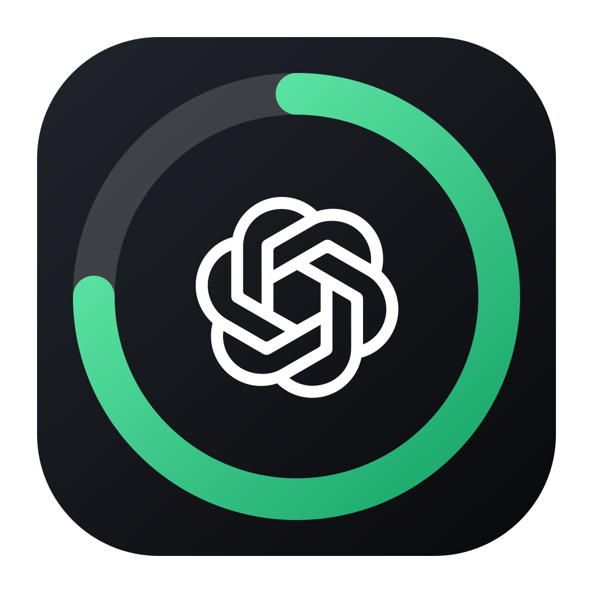
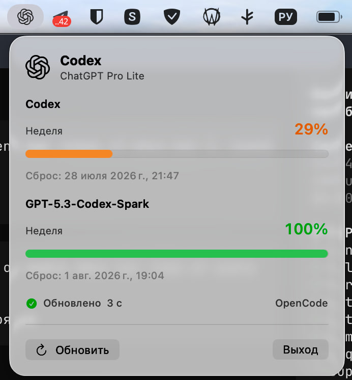

<p align="center">
  
</p>

<h1 align="center">Codex Limit Bar</h1>

<p align="center">
  Нативный индикатор оставшихся лимитов OpenAI Codex для строки меню macOS.
</p>

<p align="center">
  <a href="https://github.com/svllvsxprod/codex_limitbar/releases/latest">Скачать последнюю версию</a>
</p>

<table align="center">
  <tr>
    <td align="center" width="760">
      <h3>Поддержите разработку</h3>
      <p>Поддержка помогает развивать приложение, проверять новые версии Codex и готовить подписанные сборки.</p>
      <table align="center">
        <tr>
          <td align="center" width="350"><a href="https://t.me/tribute/app?startapp=dK9j"></a></td>
          <td align="center" width="350"><a href="https://nowpayments.io/donation/svllvsx"></a></td>
        </tr>
        <tr>
          <td align="center" colspan="2"><a href="https://t.me/svllvsxprod"></a></td>
        </tr>
      </table>
    </td>
  </tr>
</table>

<p align="center">
  
  
  
  
</p>

<p align="center">
  <a href="#возможности">Возможности</a> ·
  <a href="#установка">Установка</a> ·
  <a href="#безопасность">Безопасность</a> ·
  <a href="#разработка">Разработка</a> ·
  <a href="#ограничения">Ограничения</a>
</p>

## О Проекте

Codex Limit Bar живёт только в строке меню и показывает фактический оставшийся процент Codex, длительность окна и время следующего сброса. Приложение не создаёт обычное окно и не занимает место в Dock.

Данные обновляются сразу при открытии панели и каждые 15 секунд, пока панель остаётся открытой. После закрытия polling останавливается, а последний успешный результат сохраняется как stale snapshot при временной ошибке.

Проект является независимой утилитой и не аффилирован с OpenAI.

## Интерфейс

<p align="center">
  
</p>

## Возможности

- Фактический остаток основного недельного или короткого окна Codex.
- Дополнительные лимиты моделей, если они присутствуют в ответе аккаунта.
- Точное локальное время следующего сброса.
- Состояния загрузки, stale data, истёкшей авторизации, rate limit, сети, VPN-gate и неизвестного формата.
- Ручное обновление без параллельных дублирующихся запросов.
- Автоматическое обновление каждые 15 секунд только при открытой панели.
- Автозапуск через системный `SMAppService`.
- Автономный ChatGPT device login с хранением собственной сессии в macOS Keychain.
- Отдельная иконка limit-ring с OpenAI blossom, не совпадающая с официальным Codex client.
- Нативная реализация на SwiftUI и AppKit без сторонних runtime-зависимостей.

## Установка

1. Скачайте `Codex-Limit-Bar-0.1.1.dmg` из [GitHub Releases](https://github.com/svllvsxprod/codex_limitbar/releases/latest).
2. Откройте DMG и перенесите `Codex Limit Bar.app` в `Applications`.
3. Запустите приложение. Для ad-hoc сборки macOS может потребовать первый запуск через контекстное меню **Открыть**.
4. В панели приложения нажмите **Автономный вход**, вставьте скопированный код на открывшейся странице ChatGPT и завершите авторизацию.
5. При необходимости разрешите автозапуск в **Настройки системы → Основные → Объекты входа**.

До автономного входа приложение может временно использовать локальную авторизацию Codex CLI или OpenCode как read-only fallback. После входа Codex Limit Bar хранит и обновляет собственную сессию независимо от запущенного OpenCode.

## Проверка VPN

Перед каждым запросом к OpenAI приложение параллельно отправляет credential-free `HEAD` запросы к YouTube, Speedtest и WhatsApp.

- Если отвечает хотя бы один сервис, запрос к OpenAI разрешается.
- Если недоступны все три сервиса, приложение не читает локальный токен и не обращается к OpenAI.
- Таймаут каждой проверки составляет 5 секунд.

Это продуктовая эвристика доступности, а не проверка конкретного VPN-интерфейса или маршрута.

## Архитектура

```text
MenuBarExtra window
  -> UsageStore
  -> PublicServiceConnectivityGate
  -> ChatGPTAuthManager / Keychain
  -> LocalChatGPTAuthLoader fallback
  -> LiveCodexUsageProvider
  -> chatgpt.com/backend-api/wham/usage
```

- UI зависит от `CodexUsageProviding`, а не от transport response.
- Парсер, OAuth retry, локальная авторизация, wake refresh, VPN-gate и refresh state тестируются отдельно.
- Refresh-запросы coalesce и не создают параллельный polling loop.
- Release pipeline собирает `.app`, `.icns`, DMG и SHA-256 checksum.

## Безопасность

- Токены никогда не записываются в код, fixtures, logs или release artifacts.
- Auth-файлы принимаются только с приватными POSIX-правами без доступа group/other.
- Собственная OAuth-сессия Codex Limit Bar хранится как generic password в macOS Keychain.
- Токен хранится только в памяти и отправляется исключительно на точный HTTPS origin `chatgpt.com`.
- VPN-проверки не получают токен, account ID или другие OpenAI credentials.
- Используются ephemeral `URLSession`, отключённый URL cache и bounded timeouts.
- Приложение только читает auth-файлы Codex/OpenCode и никогда их не изменяет; обновляется только собственная Keychain-сессия.

Подробности источника данных: [`docs/usage-source.md`](docs/usage-source.md).

## Разработка

Требования:

- macOS 14 или новее.
- Xcode 26 / Swift 6.2 или новее.
- Apple Silicon для текущего готового DMG.

```bash
swift test
swift run CodexLimitBar
```

Сборка app bundle:

```bash
./scripts/build-app.sh
open dist/CodexLimitBar.app
```

Сборка DMG:

```bash
./scripts/build-dmg.sh
```

Артефакт и SHA-256 checksum будут записаны в `release/`.

## Ограничения

- `wham/usage` используется официальным open-source Codex client, но не документирован как стабильный публичный API.
- Fallback на локальный OpenCode OAuth является неподдерживаемой интеграцией и может измениться вместе с форматом OpenCode auth.
- Приложение не обновляет и не принимает во владение OAuth credentials другого клиента; автономный device login создаёт отдельную app-owned сессию.
- Текущий публичный DMG собран для Apple Silicon.
- Сборка подписана ad-hoc и не нотарифицирована Apple; для публичной production-дистрибуции потребуется Developer ID и notarization.
- macOS может потребовать ручное подтверждение login item.
